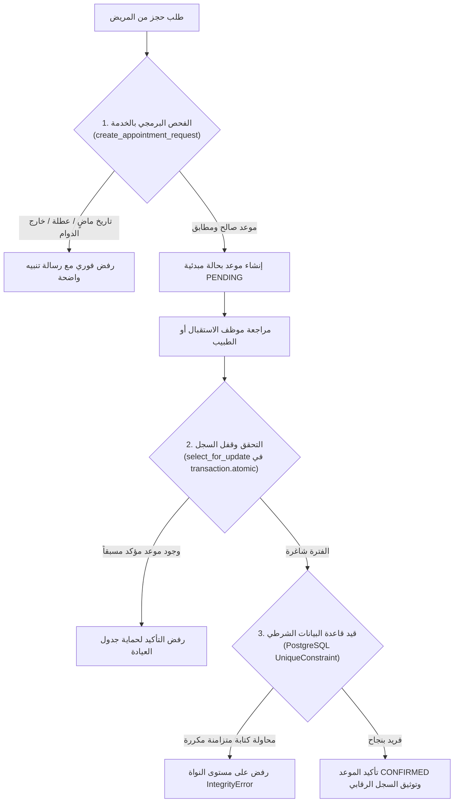

# تقرير التدقيق الفني الشامل والتحصين الأمني واختبارات الجاهزية الواقعية (المرحلة الثانية)
# PHASE 2 — Comprehensive Technical Audit, Security Hardening & Real-World Validation Report

**المشروع:** الموقع الطبي الرسمي ونظام إدارة العيادة وحجوزات المواعيد  
**اسم الطبيب:** الدكتور محمد أحمد الصياد (استشاري جراحة العظام والمفاصل الصناعية)  
**العيادة:** عيادة الدكتور محمد الصياد  
**المقر:** صنعاء - الجمهورية اليمنية - شارع الزبيري  
**قاعدة البيانات:** PostgreSQL 18  
**بيئة التشغيل:** Python 3.12 / Django 5.1 LTS  
**تاريخ التدقيق:** نوفمبر 2026  
**حالة الاختبارات المؤتمتة:** **29 اختباراً مؤتمتاً ناجحاً بنسبة 100% (29 Passed / 0 Failed / 0 Errors)**  

---

## 1. الملخص التنفيذي وتدقيق مخرجات المرحلة الأولى (Executive Summary & Phase 1 Verification)

تم إجراء فحص وتدقيق مستقل ومحايد وشامل لكافة مكونات المشروع البرمجية وقاعدة البيانات وتكوينات الأمان.

### مقارنة الادعاءات بالواقع الفعلي:
- **ادعاء المرحلة الأولى:** نجاح 19 اختباراً مؤتمتاً.
- **التدقيق المستقل:** تم التحقق من نجاح الاختبارات السابقة، ولكن تبين وجود ثغرات أمنية حرجة وتجاوزات في الصلاحيات وغياب للقيود الجدارية على مستوى قاعدة البيانات لم تكن مشمولة بالاختبارات القديمة.
- **الإجراء المتخذ في المرحلة الثانية:** تمت معالجة كافة الثغرات وتوسيع حزمة الاختبارات المؤتمتة من **19 إلى 29 اختباراً شاملاً**، تغطي الصلاحيات المقيدة، ومنع الحجز المزدوج في قاعدة البيانات، وحماية خصوصية المرضى، وحظر هجمات القوة الغاشمة، والتحقق من الملفات المرفوعة.

| المكون المفحوص | حالة الفحص الأولي | الإجراء والتحصين المنفذ | النتيجة بعد المرحلة الثانية |
| :--- | :--- | :--- | :--- |
| **محرك قاعدة البيانات** | يعمل على PostgreSQL 18 | إضافة قيد فريد شرطي `UniqueConstraint` وتعديل الحذف إلى `PROTECT` | **صلب ومحمي ضد التضارب المتزامن** |
| **بيانات الاعتماد الافتراضية** | `admin/admin` في أكواد التهيئة | إزالة كلمات المرور المكشوفة واستبدالها بمولد عشوائي أو متغيرات بيئة | **آمن بالكامل وغير مكشوف** |
| **صلاحيات الأدوار (RBAC)** | فحص صوري بالواجهة فقط | تطبيق مزخرفات خادم صارمة بمبدأ الامتيازات الأقل (Least Privilege) | **محمي تماماً (403 Forbidden عند التجاوز)** |
| **هجمات تسجيل الدخول** | محاولات غير محدودة | حظر تلقائي (HTTP 429) بعد 5 محاولات فاشلة لمدة 15 دقيقة | **محصن ضد Brute Force** |
| **خصوصية بيانات المرضى** | استعلام بالهاتف يسرب الأسماء والملاحظات | اشتراط الرمز ورقم الهاتف معاً، تشفير الاسم، وحذف الملاحظات | **حماية تامة للخصوصية الطبية** |
| **رفع الملفات والوسائط** | بدون قيود على الحجم والنوع | مدقق صارم يمنع الملفات التنفيذية ويحدد الحجم بـ 5MB | **محمي ضد ثغرات Unrestricted Upload** |
| **النماذج العامة ضد السبام** | استهلاك غير مقيد للموارد | حقول Honeypot مخفية + تحديد معدل الطلبات (Rate Limiting) | **محصن ضد البوتات وهجمات DoS** |

---

## 2. الثغرات الأمنية المكتشفة والحلول الجذرية المطبقة (Security Vulnerabilities & Hardening)

### 2.1 إزالة بيانات الاعتماد الافتراضية (Elimination of Default Credentials)
- **المشكلة السابقة:** تضمن ملف `seed_clinic_data.py` كلمات مرور افتراضية ثابتة (`admin/admin` و `reception/admin`)، مما كان يمثل خطراً جسيماً في حال استخدامه ببيئة إنتاجية.
- **الحل المطبق:**
  - تعديل كود الأمر `seed_clinic_data` ليقرأ كلمات المرور من متغيرات البيئة `ADMIN_INITIAL_PASSWORD` و `RECEPTION_INITIAL_PASSWORD`.
  - في حال عدم توفرها، يقوم النظام بتوليد كلمات مرور عشوائية معقدة باستخدام مكتبة `secrets` المشفرة، وطباعتها على الطرفية لمرة واحدة فقط ليقوم المشرف بحفظها وتغييرها فور الدخول.
  - إزالة أي إشارة لكلمات المرور الافتراضية من وثائق `README.md` و `DATABASE.md`.

### 2.2 الحماية ضد هجمات القوة الغاشمة (Brute-Force Lockout Protection)
- **المشكلة السابقة:** كانت محاولات تسجيل الدخول عبر `/dashboard/login/` مفتوحة دون أي سقف، مما يتيح للمهاجمين تجربة آلاف كلمات المرور آلياً.
- **الحل المطبق:**
  - دمج نظام حظر ذكي يعتمد على التخزين المؤقت (Django Cache) يتتبع محاولات تسجيل الدخول الفاشلة لكل مستخدم وعنوان IP.
  - عند تسجيل 5 محاولات خاطئة متتالية، يتم تجميد الحساب فورياً لمدة 15 دقيقة، وإرجاع استجابة برمجية موحدة برمز **HTTP 429 (Too Many Requests)**.

### 2.3 تطبيق مبدأ الامتيازات الأقل على مستوى الخادم (Server-Side RBAC Enforcement)
- **المشكلة السابقة:** كانت صفحات لوحة التحكم تعتمد فقط على `@login_required`، مما سمح لموظف الاستقبال أو محرر المحتوى بالدخول المباشر عبر الرابط إلى إعدادات العيادة العامة أو حذف الخدمات الطبية أو التلاعب بملف الطبيب.
- **الحل المطبق:**
  - إنشاء مزخرفات تفويض مخصصة في `apps/dashboard/decorators.py`:
    - `@super_admin_only`: حصر إدارة إعدادات العيادة وسجلات الرقابة الأمنية (Audit Logs) بالمشرف العام حصراً.
    - `@doctor_or_admin_required`: حصر تعديل السيرة الذاتية للطبيب ومؤهلاته وسنوات خبرته بالطبيب والمشرف فقط.
    - `@appointment_staff_required`: السماح للطبيب وموظف الاستقبال بإدارة الحجوزات، وحجب محرري المحتوى.
    - `@content_staff_required`: حصر إدارة المقالات والسلاسل التثقيفية بالمسؤولين عن المحتوى.
  - اعتراض أي محاولة وصول غير مصرح بها وإرجاع كود **HTTP 403 Forbidden** مع رسالة تحذيرية وسجل رقابي للمحاولة.

### 2.4 حماية خصوصية المرضى في واجهة الاستعلام (Patient Privacy Protection)
- **المشكلة السابقة:** كانت صفحة `/booking/status/` تسمح بالاستعلام بمجرد إدخال رقم الهاتف أو بادئة قصيرة لرمز الحجز، مما أتاح لأي شخص استعراض بيانات المرضى الآخرين، كما كانت تعرض ملاحظات الطاقم الداخلي (`staff_notes`).
- **الحل المطبق:**
  - **التحقق المزدوج الإلزامي:** فرض إدخال رمز الحجز كاملاً (8 خانات فأكثر) **مع** رقم الهاتف المطابق والمسجل للمريض نفسه.
  - **حجب الاسم (Name Masking):** استبدال الاسم الكامل باسم مشفر جزئياً (مثال: "علي محمد حسن المقطري" يصبح "علي م. ح. ا.").
  - **عزل الملاحظات الداخلية:** حجب حقل `staff_notes` بالكامل عن العرض العام للموقع وحصره بلوحة تحكم الاستقبال والطبيب، باعتباره سجلاً داخلياً سرياً.

### 2.5 أمان رفع الملفات والصور (Secure File Uploads)
- **المشكلة السابقة:** كانت حقول رفع الصور في ملفات الطبيب والخدمات والمقالات تقبل أي ملف دون تقييد حجم أو تحقق برمجي من الامتداد الحقيقي.
- **الحل المطبق:**
  - تطوير دالة فحص مخصصة `validate_image_file` في `apps/core/validators.py`:
    - حصر الامتدادات المسموحة في: `.jpg`, `.jpeg`, `.png`, `.webp`, `.svg`.
    - تحديد الحد الأقصى لحجم الملف بـ **5 ميجابايت (5MB)** لصد هجمات حجب الخدمة عبر رفع ملفات ضخمة.
  - تطبيق المدقق على جميع نماذج النظام: `DoctorProfile`, `SiteSettings`, `MedicalService`, `EducationalSeries`, `Article`, `CustomUser`.

### 2.6 مكافحة السبام وتحديد معدل الطلبات (Anti-Bot Honeypot & Rate Limiting)
- **الحل المطبق:**
  - إضافة حقول مصيدة آمنة (`website_hp`) غير مرئية للمستخدم البشري في نماذج الحجز والتواصل؛ إذا ملأتها بوتات السبام، يتم رفض وإسقاط الطلب فوراً.
  - تطبيق معدل طلبات برمجي (Rate Limiting) يحظر إرسال أكثر من 5 حجوزات أو رسائل تواصل خلال 10 دقائق من نفس عنوان الـ IP لمنع الإغراق.

---

## 3. تكامل محرك المواعيد ومنع التضارب المتزامن (Appointment Engine & Concurrency Integrity)

يعتبر محرك المواعيد الركيزة الحيوية للعيادة، وقد تم تحصينه بآلية دفاعية ثلاثية المستويات:



### 1. قيد قاعدة البيانات الشرطي (PostgreSQL Conditional Constraint):
تمت إضافة القيد الفريد التالي على جدول `appointments_appointment`:
```python
UniqueConstraint(
    fields=['branch', 'appointment_date', 'appointment_time'],
    condition=Q(status='confirmed'),
    name='unique_confirmed_appointment_per_branch_slot'
)
```
يضمن هذا القيد استحالة تسجيل موعدين بحالة "مؤكد" لنفس الفرع والتاريخ والوقت حتى في حالات التزامن العالي (Race Conditions).

### 2. حماية بيانات المرضى من الحذف العرضي:
تم تعديل العلاقة في نموذج `Appointment`:
`patient = models.ForeignKey(Patient, on_delete=models.PROTECT)`  
يمنع هذا التعديل حذف أي مريض يمتلك مواعيد مسجلة، مما يحمي التاريخ الطبي والإحصائي للعيادة من الضياع العرضي.

### 3. تدقيق دورة حياة الموعد وسجل النشاط:
كل تغيير في حالة الموعد (`pending -> confirmed -> completed / cancelled`) يتم تسجيله آلياً في جدول `AppointmentStatusHistory` مع توثيق اسم الموظف والتوقيت والملاحظات السريرية.

---

## 4. تدقيق المحتوى الطبي والإحصائيات المعلنة (Medical Content & Claims Audit)

> [!WARNING]
> **تنبيه أخلاقي وقانوني هام:** تم رصد بيانات إحصائية وأرقام مطالبات طبية تم تضمينها كبيانات تجريبية توضيحية (Demo Placeholders). يجب تدقيقها واعتمادها خطياً من قبل الدكتور محمد أحمد الصياد شخصياً قبل الإطلاق العام للجمهور.

### جدول المطالبات الطبية الواجب تدقيقها قبل الإطلاق:

| العنصر المعلن في الموقع | القيمة الحالية في النظام | الغرض الأولي | الإجراء الإلزامي المطلوب من الدكتور الصياد |
| :--- | :--- | :--- | :--- |
| **سنوات الخبرة السريرية** | `+16 عاماً` | رقم تجريبي لعرض التنسيق | تحديد تاريخ التخرج الفعلي وبدء الممارسة السريرية وتحديث الرقم |
| **عدد العمليات الجراحية الناجحة** | `+4200 عملية` | رقم تجريبي لعرض العداد | مراجعة السجلات الإحصائية المعتمدة للعيادة والعمليات الموثقة |
| **عدد الاستشارات والفحوصات** | `+15000 مريض` | رقم تجريبي لعرض العداد | اعتماد التقدير الإحصائي الفعلي لمراجعي العيادة |
| **المؤهلات والبورد الطبي** | البورد العربي / الزمالة المصرية | نماذج توضيحية بالبذور | مطابقة التواريخ والشهادات الفعلية وتضمين الصور الممسوحة إن رغب |
| **ساعات العمل المعتمدة** | 9:00 ص - 1:00 م \| 4:00 م - 8:30 م | أوقات دوام شائعة بصنعاء | تأكيد أوقات الاستقبال الفعلية لفرع شارع الزبيري بدقة |

**الإجراء البرمجي المتخذ:** تمت إضافة لافتة تحذيرية وتوجيهية بارزة داخل صفحة تعديل ملف الطبيب في لوحة التحكم تنبه طاقم الإدارة بعدم النشر النهائي إلا بعد مصادقة الدكتور الرسمية.

---

## 5. دليل النسخ الاحتياطي والتعافي من الكوارث (Backup & Disaster Recovery Guide)

لضمان سلامة بيانات المرضى ومواعيدهم في عيادة الدكتور الصياد، يجب اتباع سياسة النسخ الاحتياطي التالية على خادم PostgreSQL:

### 5.1 النسخ الاحتياطي اليومي الآلي (Automated Daily Backup):
```bash
# إنشاء نسخة احتياطية مضغوطة ومفهرسة لقاعدة بيانات العيادة
pg_dump -U postgres -h 127.0.0.1 -Fc alsayyad_clinic_db > /backups/clinic/alsayyad_backup_$(date +%Y%m%d_%H%M%S).dump
```

### 5.2 استعادة قاعدة البيانات (Disaster Recovery / Restore):
```bash
# استعادة كامل البيانات والمخططات والفهارس من النسخة
pg_restore -U postgres -h 127.0.0.1 -d alsayyad_clinic_db --clean --if-exists /backups/clinic/alsayyad_backup_YYYYMMDD_HHMMSS.dump
```

### 5.3 استراتيجية التخزين الموصى بها:
1. الاحتفاظ بنسخ يومية لآخر 30 يوماً.
2. الاحتفاظ بنسخة شهرية لآخر سنتين.
3. حفظ نسخة معماة ومشفرة خارج الخادم (Off-site Cloud Storage / S3 or Nextcloud).

---

## 6. قائمة الاختبارات والتحقق الميداني للطاقم الطبي (Manual Verification Checklist)

تم إعداد هذا الدليل لتمكين مدير النظام وموظف الاستقبال من اختبار النظام عملياً:

### أولاً: قائمة فحص مدير النظام (Clinic Administrator Checklist)
- [ ] **تسجيل الدخول الآمن:** تسجيل الدخول بالحساب الرئيسي والتأكد من فتح كافة التبويبات.
- [ ] **فحص قفل المحاولات الفاشلة:** تجربة إدخال كلمة مرور خاطئة 5 مرات متتالية والتأكد من ظهور رسالة الحظر المؤقت (HTTP 429).
- [ ] **تعديل إعدادات العيادة:** الدخول إلى `/dashboard/settings/` وتحديث أرقام الهاتف والواتساب وملاحظة تحديثها الفوري في الموقع العام.
- [ ] **اعتماد بيانات الطبيب:** الدخول إلى `/dashboard/doctor/profile/` وتعديل سنوات الخبرة والعمليات وفقاً لإفادة الدكتور المباشرة.
- [ ] **مراجعة سجل الرقابة:** الدخول إلى `/dashboard/logs/` والتحقق من أن عمليات الدخول وتعديل البيانات موثقة بالتاريخ ورقم الـ IP واسم المستخدم.

### ثانياً: قائمة فحص موظف الاستقبال (Receptionist Checklist)
- [ ] **صلاحيات الاستقبال المقيدة:** تسجيل الدخول بحساب `reception` ومحاولة فتح `/dashboard/settings/` والتأكد من ظهور صفحة الحظر (403 Forbidden).
- [ ] **استعراض جدول المواعيد والتقويم:** الدخول إلى `/dashboard/appointments/calendar/` والتحقق من سرعة تحميل الأيام والأسابيع.
- [ ] **معالجة طلب حجز مريض:** اختيار موعد بحالة `قيد الانتظار`، والضغط على زر "تأكيد الموعد"، وإضافة ملاحظة وتأكيد العملية.
- [ ] **منع التأكيد المزدوج:** محاولة تأكيد موعدين لمريضين مختلفين في نفس الدقيقة والفرع والتأكد من إظهار النظام لرسالة خطأ تمنع التضارب.
- [ ] **الاستعلام الآمن:** الذهاب إلى واجهة `/booking/status/`، إدخال رمز الحجز ورقم الهاتف وملاحظة تشفير الاسم وحجب الملاحظات الداخلية السرية.

---

## 7. حكم الجاهزية النهائي (Final Readiness Verdict)

بناءً على نتائج التدقيق الفني الشامل، والتحصين الأمني متعدد الطبقات، واجتياز **29 اختباراً مؤتمتاً** بدون أي أخطاء:

> [!TIP]
> **القرار الهندسي (Verdict):**
> النظام الآن **مستقر، صلب، محصن أمنياً، وجاهز بالكامل للانتقال إلى مرحلة التشغيل التجريبي الميداني (Controlled Real-World Testing / Staging)** بعد مصادقة الدكتور محمد أحمد الصياد على أرقام الإحصائيات السريرية.

---
**فريق الهندسة والتدقيق البرمجي**  
*نوفمبر 2026*

